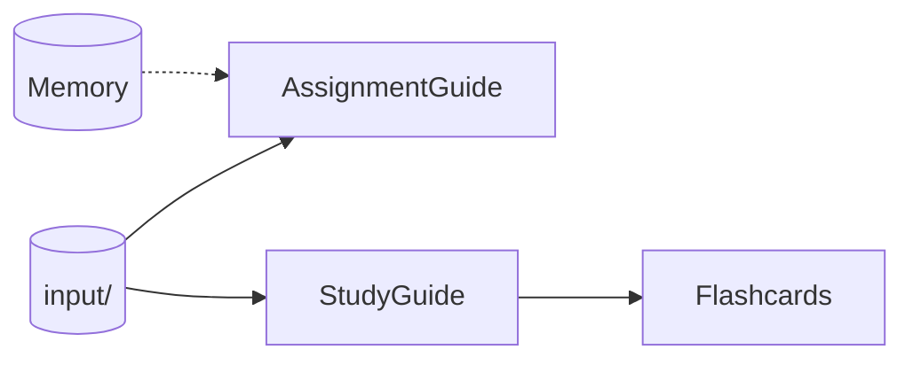

<p align="center">
  
</p>

<h1 align="center">LearningSpace</h1>

<p align="center">
  <strong>Turn a folder of course material into a guided study system.</strong><br>
  Assignment guides · study guides · answer keys · flashcards · durable memory
</p>

<p align="center">
  <strong>OpenCode 2.x</strong> · <strong>Obsidian vault</strong> · <strong>Python 3.x</strong> · <strong>MIT</strong>
</p>

> **LearningSpace is an OpenCode workspace template.** It installs OpenCode if
> needed, but you bring your own model provider and API key.

## What it does

LearningSpace gives every course one predictable structure:

- **One input folder.** Drop in lecture slides, PDFs, handouts, notes, and the
  assignment instructions.
- **Four generated study outputs.** Get an assignment guide, study guide, answer
  key, and Markdown flashcard deck, plus a self-contained browser deck.
- **One memory vault.** Keep course dashboards, topic notes, project state, and
  session history in an Obsidian-compatible vault.
- **Repeatable checks.** Formatting, freshness, and source coverage are verified
  before a commit.

It works for essays, problem sets, lab reports, presentations, and programming
courses. Code-specific rules only apply when code is actually part of the work.

## Quick start

```bash
git clone https://github.com/Jacob-Chamney/LearningSpace.git
cd LearningSpace
./install.sh
```

The installer:

- asks where the project directory should live, defaulting to `~/LearningSpace`
- installs missing core tools when possible
- installs OpenCode 2 if `opencode` is missing
- prompts before installing optional Glow
- installs the `memory-vault` OpenCode plugin configuration
- installs the `Learn` dashboard launcher
- enables the Git pre-commit checks
- runs the workspace checks

Then start OpenCode and connect a provider:

```bash
cd ~/LearningSpace
opencode
/connect
```

Add the course material to `input/`, then use the prompts:

```text
generate assignment guide
generate study guide
generate flashcards
```

Or launch the local dashboard:

```bash
./scripts/serve-dashboard.py
```

## Workflow



- `AssignmentGuide/` uses the assignment instructions, course material, and
  relevant memory.
- `StudyGuide/` uses only the course material in `input/`.
- `Flashcards/` uses only the study guide.
- `Memory/` stores durable notes and session history.

## What gets created

| Output | Purpose | Built from |
| --- | --- | --- |
| `AssignmentGuide/assignment-guide.md` | Step-by-step plan for the current assignment | `input/assignmentGoal.txt`, course documents, relevant memory |
| `StudyGuide/study-guide.md` | Source-grounded study guide | Course material in `input/` |
| `StudyGuide/study-guide-answers.md` | Answer key for the study-guide questions | Study guide |
| `Flashcards/flashcards.md` | Active-recall card source | Study guide |
| `Flashcards/flashcards.html` | Interactive browser flashcard deck | `Flashcards/flashcards.md` |
| `Memory/` | Durable course, topic, project, and session notes | OpenCode sessions and manual notes |

## Browser flashcards

Open `Flashcards/flashcards.html` directly in a browser. No server is needed.
Click the card or press `Space` to flip, use `←` / `→` to navigate, `S` to
shuffle, and `R` to reset. The Markdown file remains the source of truth; the
HTML deck is generated from it.

## Local web dashboard

Start the local dashboard:

```bash
./scripts/serve-dashboard.py
```

After the installer, you can also use the launcher:

```bash
Learn
```

If your shell does not see a newly installed `Learn` yet, open a new terminal
or reload your shell config.

It opens `http://127.0.0.1:8765/web/` and gives you one place to:

- edit `input/assignmentGoal.txt`
- add or remove source files
- read the assignment guide and study guide
- reveal study-guide answers inline
- open the interactive flashcard deck
- ask the read-only Plan agent questions and get help

It binds to localhost only. Markdown stays the source of truth, and every document
still has an **Open .md** link. The separate answer, memory, sources, and checks
tabs are intentionally gone: the overview is the input/help surface, and the
guides are the read surface.

Use **Settings > Appearance** to switch between the LearningSpace palette and
the included OpenCode themes. The choice is stored in the browser.

The helper chat uses the read-only Plan agent with `deepseek/deepseek-v4-pro` by
default. Override it with `OPENCODE_WEB_MODEL=provider/model` when starting the
dashboard.

## A memory vault that fits any subject

The default vault is subject-neutral:

```text
Memory/
  00 Inbox/
  01 Topics/
  02 Courses/
  03 Projects/
  04 Sessions/
  05 Review/
  06 Templates/
  07 Attachments/
```

It includes general templates for courses, topics, concepts, projects,
sessions, sources, and reviews. The `memory-vault` plugin captures successful
sessions automatically and skips `StudyGuide/` and `Flashcards/`.

## Built-in checks

Run one command after generating or editing outputs:

```bash
scripts/finalize-guides.sh
```

It builds the browser deck, then runs:

| Check | What it protects |
| --- | --- |
| `scripts/build-flashcards-html.sh` | Renders `flashcards.html` from the Markdown deck |
| `scripts/check-guides.sh` | Glow-friendly formatting, line length, section structure |
| `scripts/check-coverage.sh` | Every source document is represented in the guides |
| `scripts/check-stale.sh` | Outputs match the latest recorded sources |
| `.guide-manifest.json` | SHA-256 freshness state that survives clones and copies |

The manifest update is deliberate. The finalizer refuses to record a source
change when no generated output changed, which catches forgotten
regenerations. The Git pre-commit hook runs the same checks.

## Test before installing

```bash
./test-install.sh
```

This installs into a temporary workspace under `/tmp/opencode`, runs the hook,
and deletes the copy. It does not install OpenCode, Glow, or system packages.

Keep the temporary copy for inspection:

```bash
./test-install.sh --keep
```

## Installer options

```bash
./install.sh --help
```

Useful options:

```bash
./install.sh --target ~/LearningSpace --yes
./install.sh --target ~/LearningSpace --yes --no-opencode --no-glow
./install.sh --target ~/LearningSpace --yes --skip-deps
./install.sh --target ~/LearningSpace --yes --no-command
```

Pin an OpenCode version when reproducibility matters:

```bash
OPENCODE_VERSION=2.1.3 ./install.sh
```

## Build a shareable template

Do not distribute personal course material, generated guides, or session notes.
Build a sanitized starter instead:

```bash
./scripts/build-template.sh
```

Output:

```text
dist/LearningSpace-template/
```

The builder removes personal inputs, generated outputs, session history, project
notes, `.obsidian` state, and Git history. It keeps the installer, checks,
memory skeleton, and documentation, then runs the template smoke test.

## OpenCode setup

This section is OpenCode-specific. Other agent harnesses will not load
`AGENTS.md` or the memory plugin automatically.

- `AGENTS.md` routes behavior by folder.
- `opencode.jsonc` loads `Memory/AGENTS.md` and `Memory/Home.md`.
- `StudyGuide/` and `Flashcards/` are intentionally memory-free.
- The only custom plugin is `memory-vault` in
  `.opencode/plugins/memory/index.ts`.

The plugin:

- runs after a successful top-level OpenCode session
- writes session notes to `Memory/04 Sessions/`
- links notes from `Memory/Home.md` and the Sessions MOC
- links matching project notes
- skips subagents, other projects, `StudyGuide/`, and `Flashcards/`
- skips duplicate summaries

There are no external MCP servers configured.

## Use your own Obsidian vault

By default, the vault lives at `Memory/`. To use another folder name:

```bash
MEMORY_VAULT=MyVault opencode
```

Also update the two `Memory/...` entries in `opencode.jsonc`. The `.obsidian/`
folder is user-specific app state and is not part of the content standard.

## Reproducibility

For consistent results:

1. Pin the OpenCode version.
2. Pin the model you use.
3. Keep one source set in `input/`.
4. Run `scripts/finalize-guides.sh` after generation.
5. Use the sanitized template for sharing.

The workflow and checks are model-independent. Content is not byte-for-byte
reproducible across models: extraction, wording, and ambiguous-source decisions
still depend on the model.

## Windows and WSL

The installer targets Linux, macOS, and WSL. On Windows, use WSL and keep the
project inside the WSL filesystem, such as `~/LearningSpace`, rather than under
`/mnt/c` for better performance.

## License

MIT. See [LICENSE](LICENSE).

---

<p align="center">
  If LearningSpace helps you build a better study system, a star helps others
  find it.
</p>
