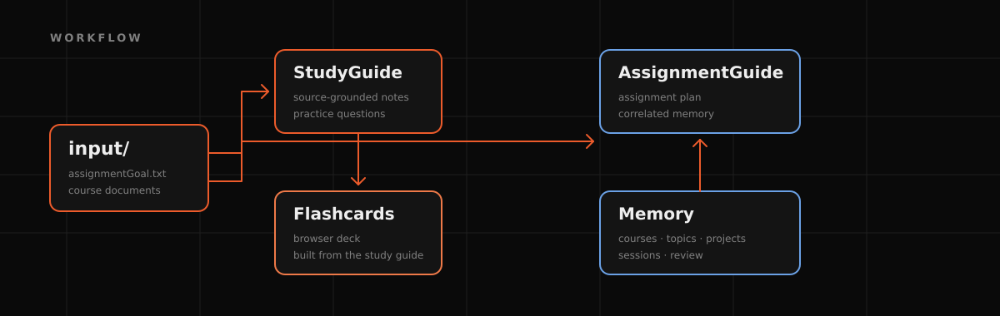
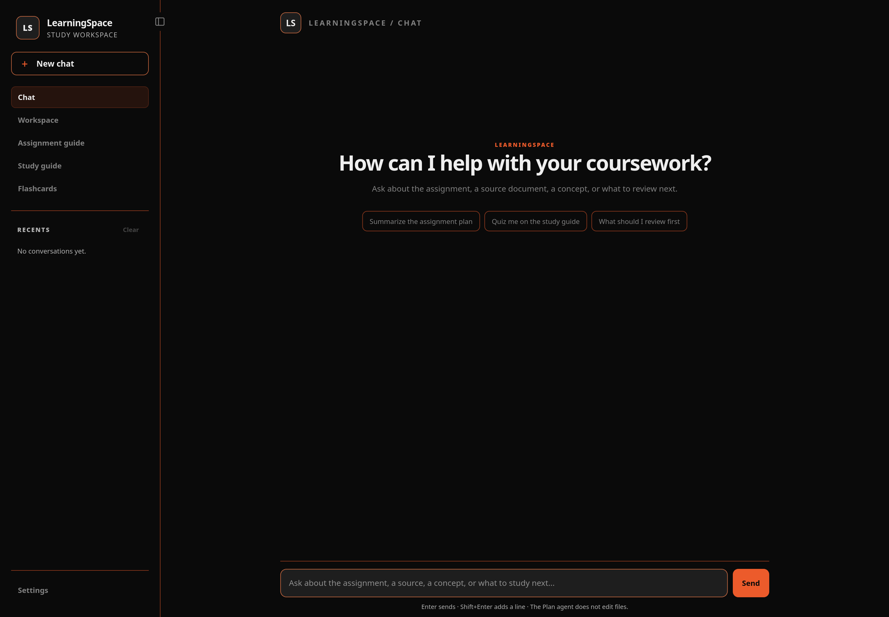
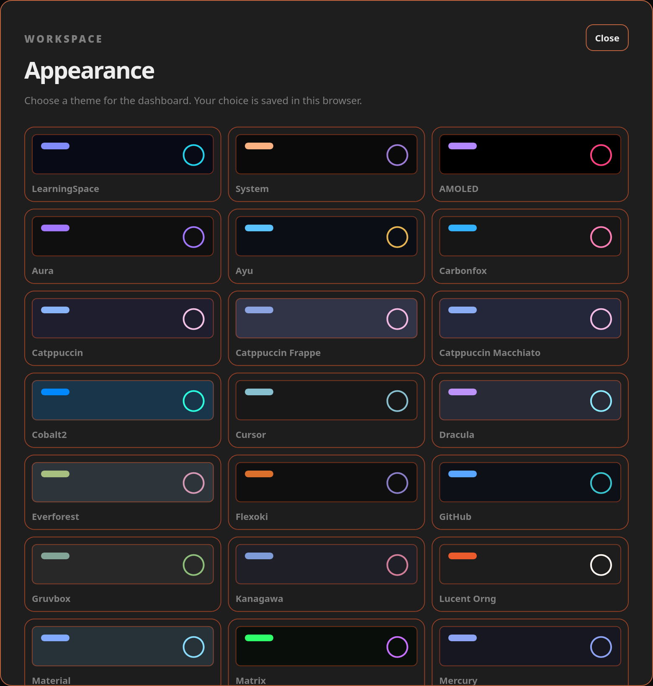

<p align="center">
  
</p>

<h1 align="center">LearningSpace</h1>

<p align="center">
  <strong>Turn a folder of course material into a guided study system.</strong><br>
  Assignment guides · study guides · answer keys · flashcards · durable memory
</p>

<p align="center">
  <strong>OpenCode 2.x</strong> · <strong>Obsidian vault</strong> · <strong>Python 3.x</strong> · <strong>MIT</strong>
</p>

<p align="center"></p>

## Why this exists

AI has stunned the way humans learn. It can answer almost anything instantly,
but instant answers can short-circuit the productive struggle that makes
learning stick. LearningSpace was built to push in the opposite direction:
source material first, guidance second, and finished answers only when
explicitly requested.

This is not a shortcut for producing submissions. It is a workspace for reading
the sources, building a plan, asking better questions, testing recall, and
keeping a durable trail of what was learned. AI should be a tool, not a crutch.

<p align="center"></p>

## Index

| Start | Build | Reference |
| --- | --- | --- |
| [Why this exists](#why-this-exists) | [Quick start](#quick-start) | [OpenCode setup](#opencode-setup) |
| [Overview](#overview) | [Installer options](#installer-options) | [Safety](#safety) |
| [Workflow](#workflow) | [Test the installer](#test-the-installer) | [Memory vault](#memory-vault) |
| [What gets created](#what-gets-created) | [Build a shareable template](#build-a-shareable-template) | [Checks](#checks) |
| [Browser flashcards](#browser-flashcards) | [License](#license) | [Reproducibility](#reproducibility) |
| [Local dashboard](#local-dashboard) | [How to get started](#how-to-get-started) | [Windows and WSL](#windows-and-wsl) |

<p align="center"></p>

## Overview

LearningSpace is an OpenCode workspace template for coursework. It keeps one
read-only source folder, derives the study tools from that source, and preserves
the working Markdown as the source of truth.

It works for essays, problem sets, lab reports, presentations, and programming
courses. Code-specific formatting rules apply only when code or formulas are
part of the assignment.

- **One input folder.** Add the assignment instructions and course documents to
  `input/`.
- **Four generated study outputs.** Build an assignment guide, study guide,
  answer key, and Markdown flashcard deck.
- **One browser deck.** Render the Markdown flashcards as a self-contained
  interactive page.
- **One memory vault.** Keep course dashboards, topic notes, project state, and
  session history in an Obsidian-compatible vault.
- **Repeatable checks.** Verify formatting, source coverage, and output freshness
  before committing.

<p align="center"></p>

## Quick start

```bash
# clone the template
git clone https://github.com/Jacob-Chamney/LearningSpace.git
cd LearningSpace

# run the interactive installer
./install.sh
```

The installer:

- asks where the project directory should live, defaulting to `~/LearningSpace`
- checks for Git, Python 3, and tar, and offers to install missing tools
- installs OpenCode 2 if `opencode` is missing
- prompts before installing optional Glow
- installs the bundled `memory-vault` OpenCode plugin
- installs the `Learn` dashboard launcher
- initializes Git and enables the pre-commit hook
- runs the workspace checks

Then start OpenCode and connect a provider:

```bash
# enter the workspace and connect a provider
cd ~/LearningSpace
opencode
/connect
```

Add the course material to `input/` (see [How to get started](#how-to-get-started)),
then use these prompts:

```text
generate assignment guide
generate study guide
generate flashcards
```

<p align="center"></p>

## How to get started

LearningSpace needs source material before chat or generation commands can help.
Add at least one of:

- the assignment instructions in `input/assignmentGoal.txt`
- lecture slides, lecture notes, handouts, readings, or other course documents
  in `input/`

You can add either through the **Workspace** tab or by copying files directly
into `input/`. Chat stays locked until at least one of these is present. Once
the material is loaded, use the prompts above.

<p align="center"></p>

## Workflow

<p align="center">
  
</p>

- `AssignmentGuide/` uses the assignment instructions, course documents, and
  relevant memory.
- `StudyGuide/` uses only the course material in `input/`.
- `Flashcards/` uses only the study guide.
- `Memory/` stores durable notes and session history.

<p align="center"></p>

## What gets created

| Output | Purpose | Built from |
| --- | --- | --- |
| `AssignmentGuide/assignment-guide.md` | Step-by-step plan for the current assignment | `input/assignmentGoal.txt`, course documents, relevant memory |
| `StudyGuide/study-guide.md` | Source-grounded study guide | Course material in `input/` |
| `StudyGuide/study-guide-answers.md` | Answer key for the study-guide questions | Study guide |
| `Flashcards/flashcards.md` | Active-recall card source | Study guide |
| `Flashcards/flashcards.html` | Interactive browser flashcard deck | `Flashcards/flashcards.md` |
| `Memory/` | Durable course, topic, project, and session notes | OpenCode sessions and manual notes |

<p align="center"></p>

## Browser flashcards

Open `Flashcards/flashcards.html` directly in a browser, or use the dashboard.
No server is required for the standalone deck.

- Click the card or press `Space` to flip.
- Use `←` / `→` to navigate.
- Press `S` to shuffle and `R` to reset.
- Theme selection follows the dashboard when the deck is opened from it.
- The Markdown file remains the source of truth; the HTML deck is generated.

<p align="center"></p>

## Local dashboard

Start the dashboard from the project:

```bash
./scripts/serve-dashboard.py
```

After installing, use the launcher:

```bash
Learn
```

It opens `http://127.0.0.1:8765/web/` and provides:

- assignment instruction editing
- source file upload and removal
- assignment and study guide reading
- inline answer reveals on study-guide questions
- the interactive flashcard deck
- a course-scoped Plan agent chat that unlocks after content is added

<p align="center">
  
</p>

Chat is locked until an assignment instruction or at least one course document
is loaded. Once unlocked, it stays within the current course material, declines
off-topic requests, and reminds you to get back on track.

### Settings and themes

Use **Settings > Appearance** to choose from the OpenCode theme set. The
default is the custom LearningSpace palette. The landing art uses the OpenCode
`orng` palette.

<p align="center">
  
</p>

The helper chat uses the read-only Plan agent with `deepseek/deepseek-v4-pro`
by default. Override it with:

```bash
OPENCODE_WEB_MODEL=provider/model ./scripts/serve-dashboard.py
```

Chat messages are sent to that model provider, and the Plan agent may inspect
workspace files to answer. For a more conservative install, use `--no-opencode`,
`--no-glow`, and `--skip-deps`.

<p align="center"></p>

## Installer options

```bash
./install.sh --help
```

Useful options:

```bash
# use the default target non-interactively
./install.sh --target ~/LearningSpace --yes

# skip OpenCode and Glow installation
./install.sh --target ~/LearningSpace --yes --no-opencode --no-glow

# skip system dependency installation
./install.sh --target ~/LearningSpace --yes --skip-deps

# skip the Learn launcher
./install.sh --target ~/LearningSpace --yes --no-command
```

Pin an OpenCode version when reproducibility matters:

```bash
OPENCODE_VERSION=2.1.3 ./install.sh
```

<p align="center"></p>

## Test the installer

Before running a full install, test it in an isolated temporary workspace:

```bash
# run a safe, isolated install test
./test-install.sh
```

The test:

- runs in a fresh directory under `/tmp/opencode`
- does not install OpenCode, Glow, or system packages
- copies the workspace
- initializes a temporary Git repository
- installs and runs the pre-commit hook
- confirms the source workspace was not modified
- deletes the temporary workspace when finished

To inspect the temporary copy afterward:

```bash
./test-install.sh --keep
```

<p align="center"></p>

## Build a shareable template

Do not distribute personal course material, generated guides, or session notes.
Build a sanitized starter instead:

```bash
# build a sanitized distributable template
./scripts/build-template.sh
```

Output:

```text
dist/LearningSpace-template/
```

The builder removes personal inputs, generated outputs, session history, project
notes, `.obsidian` state, and Git history. It keeps the installer, checks,
harness scripts, dashboard, memory skeleton, and documentation, then runs the
template smoke test.

<p align="center"></p>

## OpenCode setup

This section is OpenCode-specific. Other agent harnesses will not load
`AGENTS.md` or the memory plugin automatically.

- `AGENTS.md` routes behavior by folder.
- `opencode.jsonc` loads `Memory/AGENTS.md` and `Memory/Home.md`.
- `StudyGuide/` and `Flashcards/` are intentionally memory-free.
- The only custom plugin is `memory-vault` in
  `.opencode/plugins/memory/index.ts`.

The plugin:

- runs after a successful top-level OpenCode session
- writes session notes to `Memory/04 Sessions/`
- links notes from `Memory/Home.md` and the Sessions MOC
- links matching project notes
- skips subagents, other projects, `StudyGuide/`, and `Flashcards/`
- skips duplicate summaries

There are no external MCP servers configured.

<p align="center"></p>

## Memory vault

The default vault is subject-neutral:

```text
Memory/
  00 Inbox/
  01 Topics/
  02 Courses/
  03 Projects/
  04 Sessions/
  05 Review/
  06 Templates/
  07 Attachments/
```

It includes templates for courses, topics, concepts, projects, sessions,
sources, and reviews. The `memory-vault` plugin captures successful sessions
automatically and skips `StudyGuide/` and `Flashcards/`.

An end user can replace `Memory/` with their own Obsidian vault if it follows
the same standard. To use a different vault folder name:

```bash
MEMORY_VAULT=MyVault opencode
```

Also update the two `Memory/...` entries in `opencode.jsonc`. The `.obsidian/`
folder is user-specific app state and is not part of the content standard.

<p align="center"></p>

## Checks

Run one command after generating or editing outputs:

```bash
scripts/finalize-guides.sh
```

It builds the browser deck, then runs:

| Check | What it protects |
| --- | --- |
| `scripts/build-flashcards-html.sh` | Renders `flashcards.html` from the Markdown deck |
| `scripts/check-guides.sh` | Glow-friendly formatting, line length, section structure |
| `scripts/check-coverage.sh` | Every source document is represented in the guides |
| `scripts/check-stale.sh` | Outputs match the latest recorded sources |
| `.guide-manifest.json` | SHA-256 freshness state that survives clones and copies |

The manifest update is deliberate. The finalizer refuses to record a source
change when no generated output changed, which catches forgotten
regenerations. The Git pre-commit hook runs the same checks.

<p align="center"></p>

## Reproducibility

For consistent results:

1. Pin the OpenCode version.
2. Pin the model you use.
3. Keep one source set in `input/`.
4. Run `scripts/finalize-guides.sh` after generation.
5. Use the sanitized template for sharing.

The workflow and checks are model-independent. Content is not byte-for-byte
reproducible across models: extraction, wording, and ambiguous-source decisions
still depend on the model.

<p align="center"></p>

## Windows and WSL

The installer targets Linux, macOS, and WSL. On Windows, use WSL and keep the
project inside the WSL filesystem, such as `~/LearningSpace`, rather than under
`/mnt/c` for better performance.

<p align="center"></p>

## Safety

LearningSpace is a local, single-user tool. It is not hardened for public
exposure and has no dashboard authentication.

- Keep the dashboard bound to `127.0.0.1`. Do not port-forward it, reverse
  proxy it, or expose it to a LAN or the public internet.
- Do not put passwords, API keys, personal records, or other secrets in the
  workspace.
- Chat prompts and any workspace files the Plan agent reads are sent to the
  configured model provider. Review that provider's privacy and training
  policy before using sensitive material.
- Treat generated content as untrusted until you verify it against the source
  documents.
- Do not use the workspace to bypass academic-integrity rules or to submit
  work you do not understand.
- Use a container or virtual machine when inspecting untrusted documents.
- The installer's OpenCode installation uses the official `curl | bash` path
  and may use `sudo` for optional tools. Use `--no-opencode`, `--no-glow`, and
  `--skip-deps` if you do not want those actions.

Do not use this project to expose yourself to exploits or vulnerabilities.
Close the dashboard when you are not using it, and keep the workspace updated.


## License

MIT. See [LICENSE](LICENSE).

---

<p align="center">
  If LearningSpace helps you build a better study system, a star helps others
  find it.
</p>
